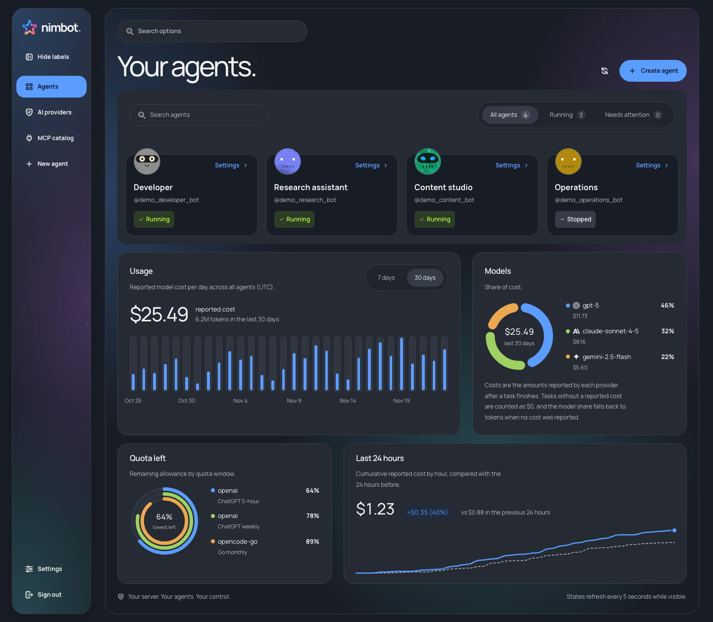

# Nimbot

**Your AI agents, on your own server.**

Nimbot is a self-hosted app for running AI agents. Create and manage them in a web panel, then give them tasks through private Telegram or Discord messages. Each agent keeps its own files and conversation history and can continue working while you’re offline.

The self-hosted app is free. You provide the server and AI provider connection.

## Get started

1. [Install Nimbot with Docker](docs/INSTALL.md). If you're coming from the older per-agent Docker layout, [start with a new data volume](docs/INSTALL.md#fresh-installation-requirement) and keep your old data.
2. Sign in to the web panel and create an agent. In **Channels**, connect your Telegram or Discord bot. You can connect both.
3. Connect a provider from **AI providers**. Under **Model and usage**, choose a model for your agent or use the default.
4. Send the bot a private message from the owner account you configured. The first message links your chat and starts your first task.

See the [first-agent setup guide](docs/INSTALL.md#create-your-first-agent) for step-by-step instructions.

## What you can do

- Ask an agent to work with files, run terminal commands, or use a browser. Send documents and receive generated files in the same chat.
- Queue tasks, follow progress, and review results or cancel active work. The panel shows recent executions and model usage.
- Write Markdown rules shared by every agent in **Rules**, or rules for one agent in its own **Rules** section. Agent rules take precedence over shared rules, and changes apply from the next task. Rules guide the model; tool approvals still apply.
- Run saved prompts on a schedule or trigger them from another service with a webhook. [Scheduled tasks](docs/SCHEDULES.md)
- Connect HTTPS and local `npx` or `uvx` MCP tools, configure shared credentials or private environment variables, manage per-agent access, and approve writes in chat. Agents can also hand off work to other agents with owner approval. [Application tools](docs/ARCHITECTURE.md#application-tools)

## Panel language

The web panel supports English and Spanish. It uses the first supported language in your browser preferences and defaults to English. Choose a language on the sign-in page or in **Settings → Language** to save it for this browser.

## Architecture

Docker runs the panel, server, and one process per agent in a single non-root container. SQLite and agent workspaces are stored in a persistent Docker volume. [Architecture and storage](docs/ARCHITECTURE.md)

## Security limitations

Agents and the server share one OS account. An agent with terminal access can read or change other agents’ files and access installation secrets. Use separate installations when you need isolation. [Security limitations](docs/OPERATIONS.md#security-limitations)

## Documentation

- [Installation, upgrades, and uninstall](docs/INSTALL.md)
- [Chat commands, backups, and troubleshooting](docs/OPERATIONS.md)
- [Development and contributing](CONTRIBUTING.md)

## Future work

The [roadmap](docs/ROADMAP.md) lists deferred features, including more messaging options, stronger isolation, and managed hosting.

## License

Nimbot is released under the [Apache License 2.0](LICENSE).
